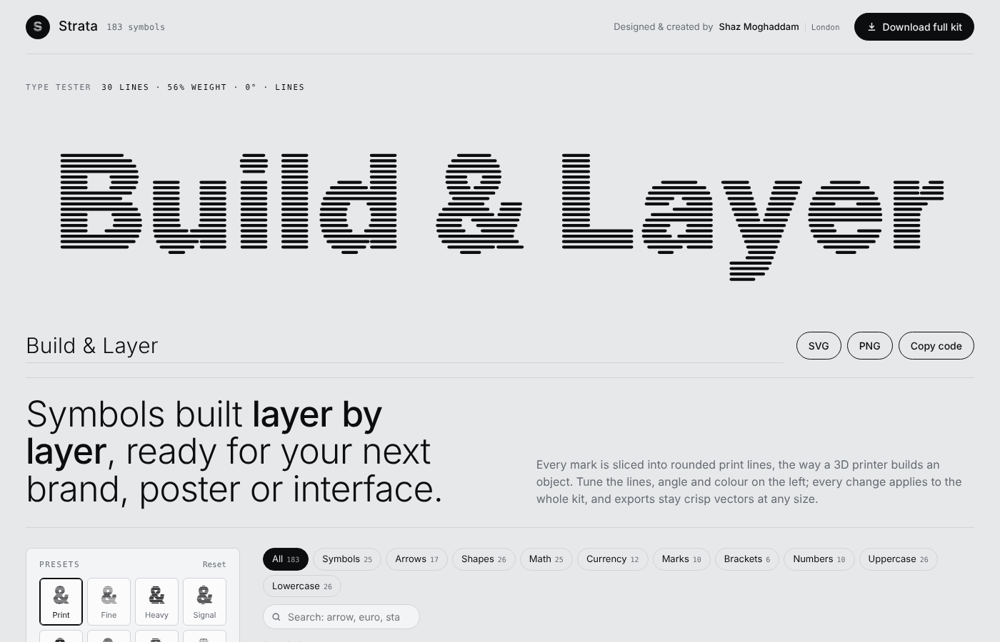
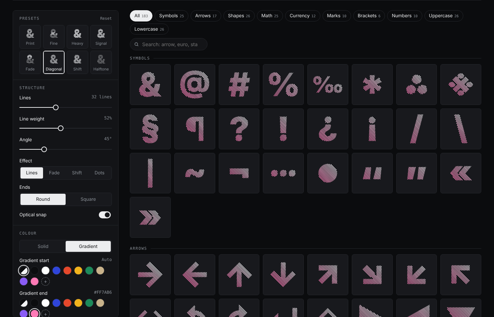

# Strata Symbol Kit

**183 layered-line symbols, letters and numbers for designers and creators.**
Every mark is sliced into rounded print lines, the way a 3D printer builds an object. Tune the lines, angle and colour in the browser, then export clean vectors.

**[Open the live kit →](https://shazmoghaddam.github.io/strata-symbols/)**



## What's inside

| Set | Count | Examples |
| --- | --- | --- |
| Symbols | 25 | & @ # % * § ¶ ? ! « » |
| Arrows | 17 | → ← ↑ ↓ ↗ ↺ ↵ ⇧ ▶ |
| Shapes | 26 | circle, ring, squircle, star, sparkle, burst, heart, bolt, waves, eye |
| Math | 25 | + − × ÷ = ≠ ≈ ∞ √ ∫ π ∑ Δ Ω |
| Currency | 12 | $ £ € ¥ ₿ ₹ ₽ ₩ ₺ ₴ ₱ ¢ |
| Marks | 10 | © ® ™ ✓ ✗ ⌘ ⌥ ⏎ |
| Brackets | 6 | ( ) [ ] { } |
| Numbers | 10 | 0–9 |
| Uppercase | 26 | A–Z |
| Lowercase | 26 | a–z |

## Using the live kit

- **Presets:** Print, Fine, Heavy, Signal, Fade, Diagonal, Shift and Halftone.
- **Structure:** line count (12–64), line weight, angle (0–180°), four effects (Lines, Fade, Shift, Dots), round or square ends, and optical snap, which aligns each symbol to the line grid so curves don't leave stray fragments.
- **Colour:** any ink and background, a two-colour gradient across the layers, and disc or square frames.
- **Type tester:** type any word or name and it renders in the same style, ready to export as a wordmark.
- **Export:** SVG, PNG (512, 1024 or 2048 px), a CSS class, or a ZIP of a whole set with SVGs, PNGs and an SVG sprite.



## Use the files directly

The repo also ships the default "Print" style, ready to drop in:

- [`svg/`](svg) holds 183 standalone SVGs on a 100 × 100 viewBox.
- [`sprite.svg`](sprite.svg) is a one-colour sprite whose symbols inherit CSS `color`:

```html
<svg width="32" height="32" style="color:#2f45d9">
  <use href="sprite.svg#strata-ampersand"/>
</svg>
```

Every layer is plain path data, so the files edit cleanly in Figma, Illustrator, Sketch or code.

## How it works

`src/gen2.py` reads glyph outlines from Inter Display Black (and builds the original geometric shapes with Shapely), resolves contours and counters, and writes `src/strata.json`. `src/engine.js` slices those outlines with evenly spaced scanlines at any angle, unions overlapping letters, tries several grid offsets to avoid slivers, and emits rounded-rectangle, dot or bar paths. The page runs the same engine live in the browser with no build step.

```bash
pip install fonttools shapely
python3 src/gen2.py        # rebuild outlines
node src/contact-sheet.js  # render a quick contact sheet to sheet.svg
```

## Licence

The code is released under the [MIT licence](LICENSE). The symbols are free to use in personal and commercial work, with no attribution required.

Letters, numbers and typographic symbols are derived from [Inter](https://rsms.me/inter/) by Rasmus Andersson, licensed under the [SIL Open Font License 1.1](https://openfontlicense.org). The geometric shapes are original.

---

Designed and created by **[Shaz Moghaddam](https://shazmoghaddam.github.io/)**, London.
